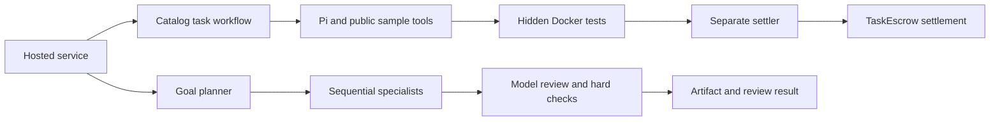

# Tabby architecture

Tabby is a hosted Agent workspace with two economic paths: earning from escrow-backed programming tasks, and spending cash on personal goals. Both reuse durable payment journals, but their acceptance and financial outcomes differ. This guide describes the implementation at `0526070`; the [verification guide](VERIFICATION.md) separates reproducible checks from historical live runs.

## Two economic paths

| | Escrow-backed tasks | Cash-funded personal goals |
| --- | --- | --- |
| Hosted actions | `task`, `reward-task`, `metered-task`; `autonomous` runs bounded task sessions | `goal` |
| Funding | A publisher has escrowed the reward. Inference uses cash, explicitly authorized task credit, or supported reward credits. Credit pays a whitelisted provider directly. | Every planner, specialist, reviewer and revision call uses `InferCredit.fetch`, `taskId=0`, cash only. |
| Execution | A trusted host selects/accepts a configured catalog task. Pi produces Python and can test public samples. | A model plans 1–3 sequential specialist stages; each receives the original goal and prior outputs. Optional bounded chain reads provide evidence. |
| Acceptance | Separate Arena runs hidden Docker tests; its separate settler signs the `TaskEscrow.settle` transaction. The host verifies canonical receipts and final task/loan state. | A separate reviewer call checks the final artifact, with deterministic length/date checks enforced by the host. At most one revision and re-review. |
| Financial outcome | Successful settlement deducts the protocol fee, repays an active loan's principal/fee and credits the residue. Failure/expiry follows the contract state machine. Relevant outcomes feed ERC-8004 reputation. | Cash spending and confirmed refunds are recorded. No escrow reward, task loan, repayment or reputation increment is invented. |

The two planners have distinct jobs. [Hosted autonomy](../services/hosted-agents/src/autonomy-executor.ts) reads balances, debt, costs and remaining limits, then accepts only `run-task(modelId,funding)` or `stop`; [Pi autonomy](../packages/pi-loop/src/autonomy.ts) validates these actions before launching the original child workflow. The [goal commander](../services/hosted-agents/src/goals/commander.ts) decomposes a supplied goal into configured specialist types. Neither planner can add tools, providers, wallet permissions or budgets.

Goal planning, execution and review use separate calls on the goal's persisted selected model route. “Independent review” describes the separation of calls and instructions; it does not imply a different model, a separate organization or proof of factual correctness. A reviewed code artifact is not executed by this goal pipeline. The review result must pass the host's hard checks as well; an executor's claim or a stored `completed` stage alone is not a success receipt.

## Payment and inference units

| Service | Purchase and consumption | Source |
| --- | --- | --- |
| Ordinary Relay: goals, task planning, legacy cash calls | One fixed operator quote per call. Actual model/token usage is recorded; it does not change the already paid price. | [Relay](../services/provider-relay/src/relay.ts), [goal payment](../services/hosted-agents/src/goals/payment.ts) |
| Prepaid inference allowance: `metered-task` | One task-bound package purchase issues credits without calling an LLM. The request digest binds package size and model catalog. The hosted gateway reserves credits before Magpie dispatch and settles them using actual input/output usage at configured rates. | [Allowance relay](../services/provider-relay/src/allowance.ts), [metered adapter](../services/hosted-agents/src/metered-task.ts), [gateway ledger](../services/hosted-agents/src/inference-gateway.ts) |
| Fixed-price solving service B: `task` | One purchase covers a bounded provider-side Pi solve, potentially several model rounds. Early success does not rebate the fixed price; its explicit nondelivery refund rule differs from ordinary Relay. | [Solving relay](../services/provider-relay/src/fixed-price.ts), [solve specification](../packages/pi-loop/FIXED_PRICE.md) |

Token rates consume **microcredits**, package/call prices spend **settlement-asset raw units**, and borrowing creates **principal plus a fee**. These are separate quantities. Monad testnet configuration uses chain `10143` and six-decimal test USDC; local fixtures use Anvil `31337`. Quote budgets exclude native gas and do not establish a supplier invoice. Unused package credits stay bound to their task; they are not transferable tokens or cash.

[Magpie](magpie-gateway.md) supplies configured physical model routes with implicit retries disabled by the pinned build/patch. It does not underwrite loans or verify task completion. The application's own 402 quote/receipt protocol and SDK perform payment binding; standard x402 scheme/facilitator compatibility has not been established.

## Durable state and recovery

The [hosted service](../services/hosted-agents/src/service.ts) binds the authenticated owner, Agent, UUID and request parameters; the original UUID returns or resumes that run. An unresolved active run retains its budget reservation and blocks a replacement run, with explicit funding subrequests for eligible paused runs. Restart changes interrupted `Queued`/`Running` runs to recoverable `Paused`.

[SessionStore](../packages/pi-loop/src/session.ts) writes atomic, fsynced snapshots under a single local writer lock. Stale locks require explicit recovery after the previous writer stops. This is a single-host design, not a distributed transaction coordinator.

| Boundary | Saved state | Recovery rule |
| --- | --- | --- |
| Accept/payment/settlement | Original identity, quote, `PaymentHandle`, signed transaction bytes/hash and confirmations | Reconcile the same transaction and ID. Do not create another quote or task to escape an unknown result. |
| Ordinary Relay | `Quoted → Paid → Processing → Delivered`; dispatch attempt journal and cached result | A durably delivered response can be read again. An uncertain dispatch remains blocked; only configured explicit rejection responses allow the next saved route. |
| Metered gateway | Grant source, catalog snapshot, invocation ID/digest, credit reservation and response | A completed matching invocation is cached. `DispatchIntent` surviving a crash becomes `Unknown`; `Unknown`/`UsageOverrun` freeze spending. A persisted response can settle without another model call. |
| Personal goal | Original goal/owner/wallet/route, deadline, per-stage handle, output, review and actual charges | Reuse the original stage and payment. Stop/deadline does not erase a sent payment; unresolved calls stay paused for reconciliation. |

Refunds require confirmed chain evidence. An operator may explicitly accept unknown vendor cost under narrow, separately journaled resolution rules; this is not automatic retry or proof of nondelivery. Allowance compensation additionally requires permanent ledger sealing and verification of the original payment/refund before task termination. See [core runtime](core-runtime.md) and [goal reconciliation](../services/hosted-agents/src/goals/reconciliation.ts).

## Trust and custody

The service authenticates a user's login-wallet signature and enforces owner-scoped access. It generates a separate hosted Agent wallet and stores its private key in a restricted local file; the platform controls that signer. This is hosted custody, not a user-held session-key protocol. AgentAccount enforces provider allowlists, policies and freezes; [CreditManager](../contracts/src/CreditManager.sol) relies on the configured underwriter and escrow constraints. Contract administrators retain configured protocol powers.

The Pi model/public-sample tool and the goal models receive no wallet keys, provider API keys or hidden tests. [Arena controller](../services/arena/src/controller.ts) owns hidden-test evaluation but does not load the verifier key; [Arena settler](../services/arena/src/settler.ts) alone owns that key and accepts verdicts over restricted local IPC. This isolates execution from signing while still trusting the configured verifier infrastructure. RPC canonical-block checks bind displayed payment/settlement facts to observed chain state; provider usage and model review remain trusted off-chain inputs.

Optional [chain lookup](../services/hosted-agents/src/goals/chain-lookup.ts) accepts at most two address/transaction targets on supported hosted networks, pins reads to blocks, limits RPC/source data, checks source against deployed bytecode and detects reorgs before saving. Missing or truncated evidence remains unknown. It performs no transaction trace, simulation, general browsing or live yield discovery.

[Public activities](../services/hosted-agents/src/scene-types.ts) are validated, persisted executor events, capped at 256 per run. The [frontend scene projection](../frontend/lib/tabby-scenes.ts) visualizes those events and confirmed results. Animation timing never creates a payment, acceptance or reputation fact.

## Source reading route and scope

Start with [hosted service](../services/hosted-agents/README.md), then the [task workflow and Pi](../packages/pi-loop/README.md) or [goal executor](../services/hosted-agents/src/goals/executor.ts). Follow payment evidence into [Relay](../services/provider-relay/README.md) and [SDK](../packages/sdk/src/index.ts); task settlement ends in [TaskEscrow](../contracts/src/TaskEscrow.sol), [AgentAccount](../contracts/src/AgentAccount.sol), [CreditManager](../contracts/src/CreditManager.sol) and [ERC8004Adapter](../contracts/src/ERC8004Adapter.sol).

Configured specialists are internal execution roles, not independently hired on-chain Agents. Autonomy currently chooses tasks or stops; it does not autonomously play games, publish subtasks or recruit external Agents. Free practice games do not issue real rewards. The runtime does not provide arbitrary shell/file/account access for personal goals, open expert discovery, a public LP pool, universal fact verification or distributed multi-writer deployment. Historical live validation does not establish a publicly hosted, always-available service; consult [verification](VERIFICATION.md) for evidence and reproduction boundaries.
