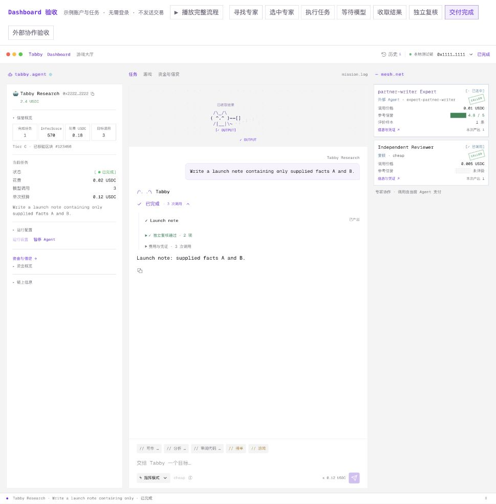
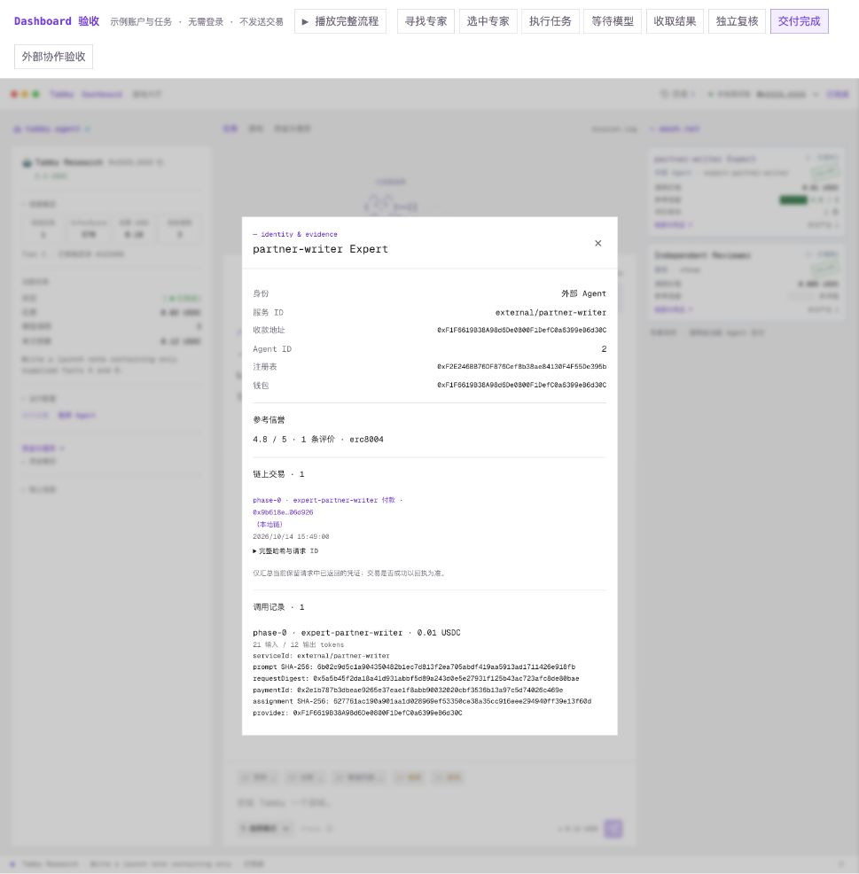

# Tabby execution evidence · 2026-10-14

Start with the [capability, source, and reproduction guide](../../../docs/autonomous-collaboration-20261014.md). Each JSON report describes its own environment and request; the runs are separate.

| Capability | Saved result | Environment / record |
| --- | --- | --- |
| **Game → inference resources → verified income** | Zero resources → sponsored reward → cash plus task credit or reward tokens → Docker-verified task → settlement. `manualRefuel` also retains the original task and acceptance transaction after a game refill. | Anvil `31337`, controlled models, actual HTTP/game execution, independent Docker/Arena · [automatic-game.json](automatic-game.json) |
| **Budget-aware model routing** | `strong → cheap → cheap → cheap`; payments total `60000` within `70000`. Earlier output survives; replay adds no call. | Anvil `31337`, controlled models, actual cash payments, separate model review · [model-fallback.json](model-fallback.json) |
| **Independent external Agent hiring** | HTTP discovery and 402 payment to a separately registered provider; three paid stages, saved output, review, and original-request recovery. | Anvil `31337`, fixture registry/reputation, controlled models, actual HTTP/payments · [external-hire.json](external-hire.json) |
| **Monad provider admission** | Agent `1999` identity and provider whitelist verified; saved successful transaction and canonical block receipt. | Monad Testnet `10143`; identity/whitelist admission only, no new game or model run · [external-provider-monad.json](external-provider-monad.json) · [transaction](https://testnet.monadvision.com/tx/0x6db97c6add9261de6153df80d7afc876bea2817bc6f3202f82d0074e4d5bce3d) |

Currency uses six decimals: `10000` raw units = `0.01` test token. Reward tokens are a separate inference unit. All reports contain public summaries rather than private keys, raw signed transactions, or private RPC credentials.

From the repository root, check the **three local reports** without a wallet, Docker, model credentials, or network access:

```sh
npm run evidence:check
node scripts/check-acceptance-evidence.mjs --json
```

The checker validates saved arithmetic, payment/identity bindings, and replay invariants, and emits report checksums and request IDs. It does not reconstruct the original chain or independently verify public provenance. Use the [reproduction commands](../../../docs/autonomous-collaboration-20261014.md#reproduce-fresh-local-runs) to exercise fresh local runs.

The Dashboard preview at `http://localhost:3033/` includes an **external collaboration acceptance** action that displays the recorded expert, output, and receipts without initiating payment.

## Recorded UI projection

These screenshots show the labeled preview projecting the saved external-hiring report into the actual Dashboard components. The preview's account balances are sample UI data; the JSON report supplies the execution amounts and provenance.





Browser verification covered the completed conversation, actual external service/model/price, independent review, and the identity/payment/request/assignment evidence in the expert profile. See [Dashboard](external-dashboard.png) and [expert profile](external-profile.png). The preview account sidebar is illustrative; the external mission and profile use the saved local acceptance record above.

Final affected regression: **124 tests passed**, with no failures or skips. Workspace type checking, production frontend build, documentation links, and the offline evidence checker passed. The frontend was restarted with the new build at `http://127.0.0.1:3024/`.

The original Monad runtime and Magpie were then recovered without inference or new task/game execution. [Runtime readiness](runtime-ready.json) records 16 reachable external services (eight specializations × two models), matching identity advertisements, the bounded automatic-game configuration, and an unchanged gateway call counter. The six original escrow task fixtures are already settled or terminated; this readiness check is separate from a fresh escrow-backed task catalog and public-chain execution acceptance.
